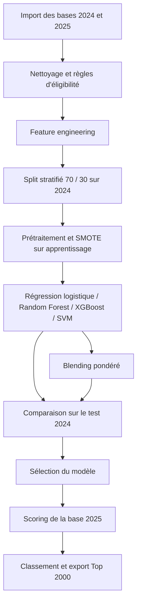

# Telecom Customer Churn Prediction — Scoring anti-churn

   

Projet de Data Science appliqué au marketing relationnel dans le secteur des télécommunications, réalisé dans le cadre du Mastère Spécialisé **Science des données pour la connaissance client — ENSAI (2025–2026)**.

**Objectif : prédire le risque de résiliation à trois mois et sélectionner les 2 000 clients à contacter en priorité dans le cadre d'une campagne de fidélisation.**

## 1. Contexte et problématique métier

Face à une hausse des résiliations, un opérateur de téléphonie mobile souhaite optimiser son budget de rétention. La contrainte budgétaire limite la campagne à 2 000 clients.

Comment identifier les clients les plus susceptibles de quitter l'opérateur, tout en fournissant aux équipes marketing des éléments pour personnaliser les actions de fidélisation ?

Le projet transforme une problématique de classification binaire en une problématique de classement et de ciblage commercial sous contrainte budgétaire.

## 2. Résultats clés

| Indicateur | Résultat | Interprétation |
|---|---:|---|
| ROC-AUC | **0,944** | Forte capacité de discrimination entre résiliés et non-résiliés |
| Capture @ 2000 | **1 669** | Nombre de résiliés identifiés parmi les 2 000 clients les mieux classés |
| Precision @ 2000 | **83,45 %** | Proportion de résiliés dans la cible |
| Lift @ 2000 | **6,74** | Concentration de résiliés 6,74 fois supérieure au taux global |

Les résultats sont ceux rapportés dans la fiche de score ; la précision à 2 000 est calculée à partir de la capture (1 669 / 2 000). Le script évalue les modèles sur le sous-ensemble test de la base historique de décembre 2024. Ces chiffres ne constituent pas une mesure de performance sur la base d'application de mars 2025, ni une mesure de résiliations effectivement évitées.

## 3. Données

Deux photographies temporelles de la clientèle sont utilisées :

| Fichier attendu par le script | Date de référence | Usage |
|---|---|---|
| `base_telecom_2024_12.txt` | 31/12/2024 | Apprentissage et évaluation |
| `base_telecom_2025_03.txt` | 31/03/2025 | Scoring des clients actifs et ciblage |

La variable cible `flag_resiliation`, disponible uniquement dans la base historique, vaut 1 si le client résilie entre le 1er janvier et le 31 mars 2025, et 0 sinon.

Les variables couvrent le profil sociodémographique, les offres et équipements, l'ancienneté et l'engagement contractuel, les options, les migrations, les réengagements et les usages (appels, SMS, data) sur les trois derniers mois.

## 4. Pipeline méthodologique



### Préparation et feature engineering

- Normalisation des types, nettoyage des dates et filtrage de la population éligible (ancienneté minimale de trois mois, cohérence des dates, exclusion des âges connus de 80 ans et plus).
- Traitement des valeurs manquantes à l'aide de règles métier et d'imputations statistiques.
- Construction de variables d'ancienneté, de fin d'engagement et de réengagement.
- Calcul des évolutions, ratios, moyennes et écarts-types des usages sur trois mois.
- Création d'indicateurs de baisse d'usage, de changements d'offre et d'équipement.
- Encodage des variables catégorielles, regroupement des modalités rares, suppression des variables à variance nulle et normalisation pour les modèles concernés.
- Rééquilibrage par SMOTE au sein des recettes d'apprentissage.

### Modèles comparés

| Modèle | Configuration |
|---|---|
| Régression logistique | Baseline statistique, moteur `glm` |
| Random Forest | `ranger`, 500 arbres, mtry = 12, min_n = 10 |
| XGBoost | Recherche de 25 configurations, validation croisée stratifiée à 2 plis, optimisation ROC-AUC |
| SVM radial | `kernlab`, cost = 1, sigma = 0,01 |
| Blending | Combinaison pondérée de Random Forest, XGBoost et SVM |

Le script classe les modèles d'abord selon le nombre de résiliés captés dans le Top 2000, puis selon la ROC-AUC. Ce choix privilégie directement l'objectif marketing.

## 5. Modèle retenu — Ensemble learning

La fiche de score retient un modèle hybride fondé sur une moyenne pondérée des scores de trois classifieurs :

```math
Score_{churn}=0.50\,p_{RF}+0.30\,p_{XGB}+0.20\,p_{SVM}
```

| Composante | Poids |
|---|---:|
| Random Forest | 50 % |
| XGBoost | 30 % |
| SVM à noyau RBF | 20 % |

Ce blending vise à exploiter la complémentarité des modèles pour capter des interactions et des relations non linéaires. Les scores sont utilisés pour classer les clients ; leur calibration en probabilités de résiliation n'a pas été démontrée.

## 6. Interprétation et applications marketing

La fiche de score identifie plusieurs signaux de désengagement, notamment la proximité de la fin d'engagement, la faible fidélité contractuelle, la baisse des usages et la gamme du téléphone.

| Signal observé | Action de fidélisation envisagée |
|---|---|
| Fin d'engagement proche | Offre de réengagement personnalisée |
| Faiblesse ou baisse d'usage | Repositionnement tarifaire ou adaptation du forfait |
| Équipement d'entrée de gamme | Proposition de renouvellement du téléphone |
| Forte valeur client et risque élevé | Traitement commercial prioritaire, sous réserve de disposer d'un indicateur de valeur |

Le scénario opérationnel recommandé consiste à recalculer mensuellement les scores, classer les clients éligibles, sélectionner le Top 2000 et transmettre la cible à un CRM ou à un outil de campagne. Il s'agit d'une recommandation de déploiement, non d'une intégration déjà réalisée.

## 7. Stack technique

- **Langage :** R
- **Manipulation et préparation :** tidyverse, lubridate, janitor
- **Machine learning :** rsample, recipes, parsnip, workflows, workflowsets, tune, dials
- **Algorithmes :** ranger, xgboost, kernlab, glm / glmnet (package chargé)
- **Déséquilibre des classes :** themis (SMOTE)
- **Évaluation et interprétation :** yardstick, pROC, vip, broom
- **Gestion des conflits de fonctions :** conflicted

## 8. Contenu du dépôt

| Fichier | Description |
|---|---|
| [`Programme_Final_Deogratias.R`](Programme_Final_Deogratias.R) | Pipeline de scoring V2 : préparation, entraînement, comparaison et export |
| [`Fiche de score_Deogratias_ALLAKONON.pdf`](Fiche%20de%20score_Deogratias_ALLAKONON.pdf) | Synthèse décisionnelle et recommandations marketing |
| [`Sujet du Projet.pdf`](Sujet%20du%20Projet.pdf) | Énoncé pédagogique du projet, Jean-Philippe Kienner |
| `README.md` | Documentation du projet |

Le sujet prévoit cinq méthodes de ciblage (aléatoire, métier, profilé, score V1 et score V2). Le script fourni ici documente la version finale V2, et non les cinq livrables séparés.

## 9. Reproduire le projet

Installer R, puis les dépendances dans une console R :

```r
install.packages(c(
  "conflicted", "tidyverse", "lubridate", "janitor",
  "rsample", "recipes", "parsnip", "workflows", "workflowsets",
  "yardstick", "tune", "dials", "vip", "themis",
  "glmnet", "ranger", "xgboost", "kernlab", "pROC", "broom"
))
```

Placer les deux fichiers de données autorisés à la racine du projet (format texte UTF-8, séparateur `;`, en-tête), puis exécuter depuis ce dossier :

```bash
Rscript Programme_Final_Deogratias.R
```

Le script fixe des graines aléatoires et produit les fichiers suivants :

| Sortie | Description |
|---|---|
| `comparaison_modeles_v2.csv` | Tableau des métriques de comparaison |
| `scores_base_2025_v2.csv` | Identifiants et scores de la population d'application |
| `C4_Deogratias_V2.txt` | Liste des 2 000 identifiants ciblés, sans en-tête |

Les données sources et les fichiers de sortie ne font pas partie des fichiers fournis pour cette documentation. L'exécution n'a pas été vérifiée avec les données réelles. Les versions des dépendances ne sont pas verrouillées ; le script contient également un appel à `install.packages("workflowsets")` qui peut être retiré après installation.

## 10. Limites et perspectives

- Confirmer les performances sur une période indépendante : le jeu de test sert également à sélectionner le modèle.
- Vérifier la calibration des scores après SMOTE et optimiser les poids du blending sur validation indépendante.
- Approfondir l'explicabilité du modèle hybride (par exemple avec SHAP ou l'importance par permutation).
- Contrôler les biais, notamment liés aux variables sociodémographiques, avant tout usage opérationnel.
- Mesurer l'efficacité réelle des campagnes via un groupe témoin, le taux de rétention incrémental et le ROI ; prédire le churn ne suffit pas à démontrer l'effet d'une offre.
- Mettre en place un suivi de la dérive des données et des performances dans le temps.

## 11. Confidentialité

Ne pas publier de données clients, d'identifiants ou de fichiers de scoring individuels sans autorisation. Vérifier également les droits de diffusion de l'énoncé pédagogique avant de le rendre public.

## Auteur

**Deogratias ALLAKONON**  
Mastère Spécialisé Science des données pour la connaissance client — ENSAI  
Projet académique 2025–2026

**Compétences mobilisées :** analyse de données, feature engineering, classification supervisée, ensemble learning, évaluation de modèles, scoring marketing et aide à la décision.
